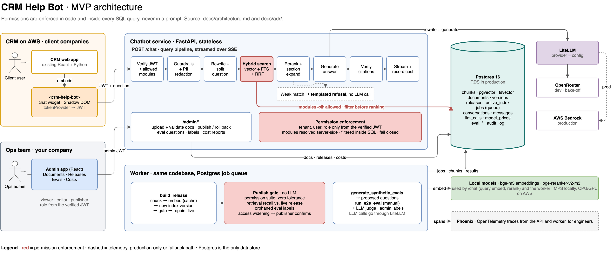

# CRM Help Bot

A help chatbot for a multi-tenant CRM. People at client companies ask how to do things in the CRM ("how do I email contacts when a deal changes stage?"). The bot answers from the product documentation, with citations, and **only** from the CRM modules each user is licensed for. An admin app lets your ops team upload versioned docs, publish them through an automatic safety gate, run evals and track LLM cost per client company.

> **Status: MVP mock.** The full request path works end to end: login tokens, permissions, streaming chat, the embeddable widget and the admin app. A deterministic **mock** stands in for retrieval and generation, and admin data lives **in memory**. The real RAG pipeline (hybrid search, reranking, LLM generation) replaces the mock behind the same interfaces. See [docs/architecture.md](docs/architecture.md).



## What's here

| Part | Where | What it does |
|---|---|---|
| **API** | `src/chatbot/` | FastAPI. `POST /chat` streams answers over SSE; `/admin/*` serves the admin app. Verifies JWTs and resolves allowed modules on the server. |
| **Chat widget** | `widget/` | `<crm-help-bot>` web component (React, Shadow DOM) to embed in the CRM. It comes with a dev page that stands in for the CRM, with a persona switcher. |
| **Admin app** | `admin/` | Separate React app: documents, releases, evals, costs, conversations. Uses API types generated from the OpenAPI schema. |
| **Data** | `data/` | Personas, module catalogue, local admins (synthetic, for development). |
| **Docs** | `docs/` | Architecture, decision records (ADRs), diagrams. |

## Quick start

**Prerequisites:** Python 3.12 with [uv](https://docs.astral.sh/uv/), Node 22, and macOS or Linux.

```bash
uv sync
```

```bash
make keys
```

```bash
make start
```

`make start` installs any missing frontend dependencies, starts all three servers in the background, and waits until each one answers:

| Server | URL |
|---|---|
| API (OpenAPI docs) | http://localhost:8000/docs |
| Chat widget on a fake CRM page | http://localhost:5173 |
| Admin app | http://localhost:5174 |

Use `make status`, `make logs` and `make stop` to check on them, follow their logs and stop them. `make restart S=api` restarts just one.

### Try it

1. Open **http://localhost:5173**. Ask *"how do I email contacts when a deal changes stage"* as `sales_manager@acme`: you get a streamed answer with sources. Switch to `sales_rep@globex` and ask again: you get a templated "not available with your access" card instead, because that persona doesn't have Campaigns.
2. Open **http://localhost:5174** and sign in as **publisher**. Under **Releases**, draft r4 has a doc that becomes visible to more users and an eval label pointing at a renamed section. Fix the label under **Evals** (follow the link on the release), publish, confirm the widening, then roll back.
3. Under **Conversations**, find the chat from step 1: redacted text, outcome and estimated cost per turn.

## Personas and roles (local only)

Chat personas come from the fictional CRM spec, `data/spec/crm_spec.yaml`. Every role × client pair is a persona, allowed (client licences ∩ role grants) + `core`. That gives 16 personas across 4 roles and 4 clients (acme, globex, kestrel, orbit). `make spec` regenerates `data/personas.yaml` and `data/module_catalogue.yaml` from the spec; don't edit those two by hand. `make check` fails if they drift. The full matrix is in [docs/backlog.md](docs/backlog.md) (S1.1.1 design) and [docs/diagrams/persona-matrix.html](docs/diagrams/persona-matrix.html).

The ones used in the walkthrough above:

| Persona | Allowed modules |
|---|---|
| `sales_manager@acme` | core, contacts, deals, campaigns, reports |
| `sales_rep@acme` | core, contacts, deals |
| `sales_rep@globex` | core, contacts, deals |
| `marketing_manager@globex` | core, contacts, campaigns |

Admin roles, from `data/admins.yaml`:

| Role | Can |
|---|---|
| viewer | read everything |
| editor | upload docs, change the draft release, write, accept and label eval questions |
| publisher | everything an editor can do, plus publish, confirm wider access, roll back and run end-to-end evals |

Locally, tokens are signed with a key in `.local/keys/` and served from a JWKS endpoint, so the validation path is the same as in production. To mint one for curl:

```bash
make token PERSONA=sales_rep@globex
```

```bash
make chat PERSONA=sales_manager@acme Q="build a dashboard report"
```

## Security rules

These hold everywhere and are tested. The full list is in [CLAUDE.md](CLAUDE.md#non-negotiable-rules).

- **Identity only from the verified token.** Tenant, user and role come from the JWT. A request body with `modules`, `tenant` or `role` is rejected.
- **Filter before ranking.** Retrieval applies the module filter inside the database query and never filters results afterwards. A chunk is visible only to users who have **all** of its modules.
- **Restricted content never reaches the model.** Refusals are templates built from the module catalogue.
- **Fail closed.** An unknown persona, unknown module or unreachable key server means deny.
- **Admin and chat tokens can't stand in for each other** ([ADR-0006](docs/adr/0006-admin-identity-and-roles.md)).
- **Conversations belong to the server.** A conversation ID that isn't yours gets a 404.

## Development

| Command | What it does |
|---|---|
| `make check` | Everything CI would run: ruff, mypy (strict), pytest, widget and admin tests and typechecks |
| `make test` | Python tests only |
| `make lint` / `make fmt` | Check or fix Python style and types |
| `make widget-test` / `make admin-test` | Frontend tests + typecheck |
| `make admin-types` | Regenerate the admin app's API types after changing API models |
| `make run` / `make widget-dev` / `make admin-dev` | Run one server in the foreground |
| `make widget-build` / `make admin-build` | Production builds |

### Local infrastructure (Postgres + pgvector, Phoenix)

Only Postgres and Phoenix run in containers, on [Colima](https://github.com/abiosoft/colima)
(`brew install colima docker docker-compose`). The API and models run natively.

| Command | What it does |
|---|---|
| `make up` | Starts Colima if needed (2 CPU, 3 GB), then Postgres and Phoenix; waits for Postgres and applies migrations |
| `make down` | Stops the containers; data is kept. `colima stop` frees the VM's memory |
| `make migrate` | `alembic upgrade head` (migrations live in `src/chatbot/db/migrations/`) |
| `make db-shell` / `make db-reset` | `psql` into the dev DB / delete all local data (asks first) |

Postgres: `localhost:5432`, database `chatbot` (tests use `chatbot_test`). Phoenix: http://localhost:6006.
With the database up, `make ingest` validates, chunks and embeds `data/docs/` into a new index
version (bge-m3 on MPS; the first run downloads about 2.3 GB) and makes it live.
`make index-list`, `make promote V=n` and `make rollback` manage versions.
`make eval` runs the retrieval evals on the live index (recall, complete recall and MRR per
category, hybrid and reranked) and saves a report to `evals/reports/retrieval/`.
Override the connection with `CHATBOT_DATABASE_URL`. Tests marked `db` skip when Postgres is down;
`REQUIRE_DB=1 make test` makes that a failure.

Project layout and conventions for contributors (and AI coding sessions) are in [CLAUDE.md](CLAUDE.md).

## Design docs

- [Architecture](docs/architecture.md): components, query path, content lifecycle, data model, cost, evals. There's also a [standalone HTML version](docs/architecture.html), and an [editable diagram](docs/architecture.drawio) for draw.io.
- Decision records:
  [0001 Postgres for vector and keyword search](docs/adr/0001-postgres-for-vectors-and-keyword-search.md) ·
  [0002 OpenRouter in development, Bedrock in production](docs/adr/0002-llm-provider-openrouter-then-bedrock.md) ·
  [0003 Postgres job queue](docs/adr/0003-postgres-job-queue.md) ·
  [0004 Content releases; modules controlled in the docs](docs/adr/0004-content-releases-and-module-control.md) ·
  [0005 Cost accounting](docs/adr/0005-cost-accounting.md) ·
  [0006 Admin identity and roles](docs/adr/0006-admin-identity-and-roles.md)

## Known limitations of the mock

- Admin data (docs, releases, evals, conversations, costs) is in memory and resets when the API restarts.
- The chat responder matches keywords and ignores releases, so publishing doesn't change answers yet.
- The publish gate's permission and retrieval checks are labelled stand-ins until the real eval suites exist.
- Redaction catches emails, phone numbers and long numbers only.
- Costs use placeholder prices until the model bake-off picks real models.

All documents, personas and client companies are synthetic.
