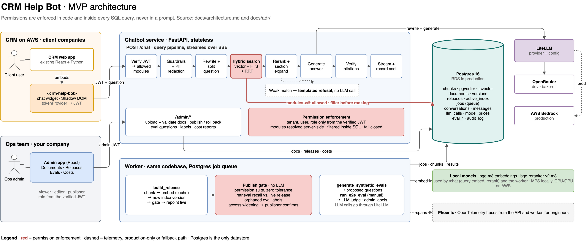
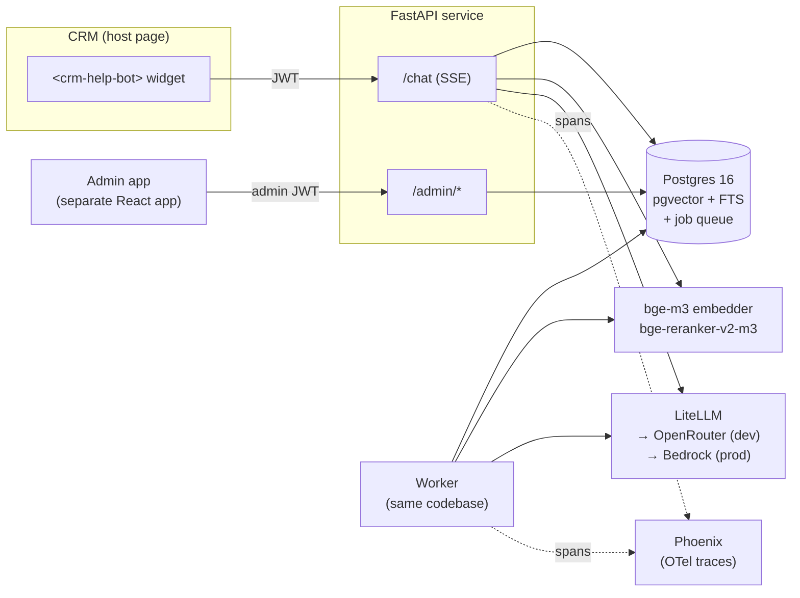
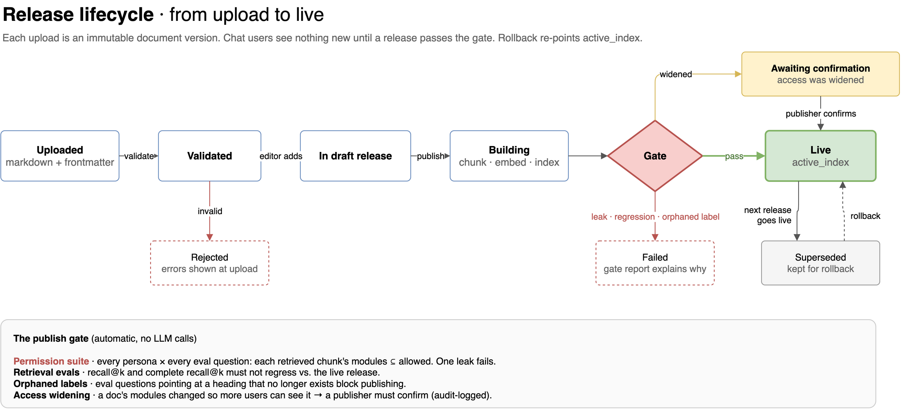
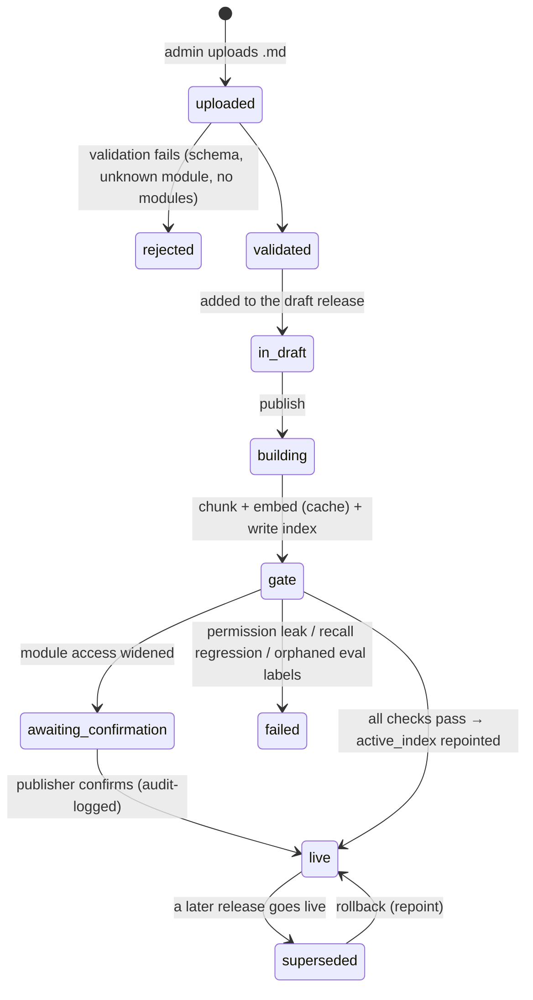

# CRM help bot: MVP architecture

Status: **proposed** (2026-11-12). Decisions are recorded as ADRs in [`docs/adr/`](adr/).
Non-negotiable rules live in [`CLAUDE.md`](../CLAUDE.md) and are not restated here; this document shows where each one is enforced.

## 1. Scope

**Goal of the MVP:** prove answer quality, permission safety and measurability (including cost) to the business, on a codebase that can be productionised rather than rewritten.

| In the MVP | Later |
|---|---|
| Chat widget embedded in the CRM (built: M0.3) | Word and PDF upload (PDF via Docling) |
| Hybrid retrieval: Postgres full-text + vector, module filter in SQL | BM25 proper (`pg_search`) if keyword evals demand it |
| Admin app: upload markdown docs, see processing status, publish / roll back releases | Assigning modules in the admin UI; two-person approval |
| Eval questions authored in the admin UI and generated synthetically, then reviewed | Component-level generation evals |
| Admin labelling of answers (judge calibration) | Per-tenant budgets and alerts |
| Cost dashboard: estimated cost per client company and per chat session | Docs per CRM release (not needed while all clients share one release) |
| Ops admins see transcripts | Client-company admins see their own users' transcripts (nice to have, §7) |
| OpenRouter for development and the model bake-off | Bedrock in production |

### Assumptions (if one is wrong, the design changes)

1. **Docs are your product documentation, shared by all client companies.** Clients don't upload their own content. There is no tenant dimension on chunks; access is by module only.
2. **All client companies run the same CRM release** (confirmed 2026-11-12). Edit history is enough: only the latest published version of each doc is live. If this ever changes, docs need a `release` dimension resolved from the tenant, like modules.
3. **At most ~100 docs** (roughly 3–5k chunks). Exact vector search, one Postgres, and a full index rebuild on every publish.
4. **Production runs on AWS.**

## 2. System overview



The editable source is [`architecture.drawio`](architecture.drawio): page 1 is this overview, page 2 the release lifecycle (§4). Re-export the PNGs after editing it. The Mermaid version below renders directly on GitHub.



| Component | Responsibility |
|---|---|
| **Widget** | Built in M0.3. Streams answers, shows sources and refusal cards. Gets its token from the CRM through `tokenProvider`. |
| **Admin app** | Documents, releases, evals, labelling, costs. A separate bundle: never shipped inside the widget. |
| **API** | `/chat` (query path), `/admin/*` (content, evals, costs). Stateless. All authorization happens here. |
| **Worker** | Same Python package, separate process (`make worker`). Runs jobs from the Postgres queue: build release, generate synthetic evals, run end-to-end evals. |
| **Postgres** | The only datastore: content, chunks, embeddings, full-text index, job queue, traces-for-cost, audit log. |
| **LiteLLM** | One client for every LLM call; the provider is config. Reports token usage for every call. |
| **Embedder / reranker** | Local models behind the `Embedder` / `Reranker` interfaces. Production compute for the reranker is an open question (§10). |
| **Phoenix** | Engineering view of traces (spans, prompts, latency). Not the admin dashboard. |

## 3. Query path (`POST /chat`)

Unchanged from CLAUDE.md except for steps 0 and 10.

0. **Conversation ownership.** A `conversation_id` in the request must exist and belong to the caller (`sub` + `tenant`), or the server returns 404, so a guessed ID reveals nothing. If the request has none, the server creates a new conversation and owns the ID.
1. Validate the JWT, then resolve allowed modules (built in M0.1).
2. Input guardrails; PII redaction before anything is stored.
3. Rewrite + decomposition (small model; skipped on the first turn).
4. Hybrid search per (sub-)query; module filter inside the SQL; RRF; dedupe.
5. Rerank, module diversity, parent-section expansion.
6. Below threshold: a templated refusal (built in M0.2), no LLM call.
7. Generate (versioned prompt, static prefix first).
8. Verify citations against the context.
9. Stream (event contract built in M0.2).
10. **Record**: one `llm_calls` row per LLM call (§7), the trace (rule 8), and the redacted message.

### Hybrid retrieval

The only metadata filter is **modules**, and it's a permission filter. The upload-date filter was dropped: only the latest published version of each doc is in the live index, so old versions can't be retrieved at all, and an upload date doesn't measure whether content is current (see the staleness report in §5).

```sql
-- One query per (sub-)query. :allowed is the caller's resolved module set.
WITH active AS (SELECT index_version FROM active_index WHERE alias = 'live'),
vec AS (
  SELECT chunk_id, row_number() OVER (ORDER BY embedding <=> :qvec) AS r
  FROM chunks, active
  WHERE chunks.index_version = active.index_version
    AND modules <@ :allowed                      -- rule 2: filter before ranking
  ORDER BY embedding <=> :qvec LIMIT :k
),
kw AS (
  SELECT chunk_id, row_number() OVER (ORDER BY ts_rank_cd(tsv, q) DESC) AS r
  FROM chunks, active, websearch_to_tsquery('english', :qtext) q
  WHERE chunks.index_version = active.index_version
    AND modules <@ :allowed
    AND tsv @@ q
  ORDER BY ts_rank_cd(tsv, q) DESC LIMIT :k
)
SELECT chunk_id, sum(1.0 / (60 + r)) AS rrf      -- reciprocal rank fusion, k = 60
FROM (SELECT * FROM vec UNION ALL SELECT * FROM kw) u
GROUP BY chunk_id ORDER BY rrf DESC LIMIT :k;
```

Postgres `ts_rank_cd` is not BM25 (there's no IDF term or proper length normalisation). That's acceptable here: RRF only uses rank order, and with ~4k chunks of product docs the vector side carries most of the recall. Keyword-recall evals decide whether to upgrade to `pg_search` ([ADR-0001](adr/0001-postgres-for-vectors-and-keyword-search.md)).

## 4. Content lifecycle

Docs are markdown with the existing frontmatter contract. **Modules are controlled in the doc's frontmatter, not in the admin UI.** A **release** is the unit of publishing: an immutable index built from a chosen set of document versions. It's the same thing CLAUDE.md calls an `index_version`.





**Upload** (`POST /admin/documents`): stores the raw file and runs validation immediately, so bad docs fail at upload rather than at publish time. A new version of an existing `doc_id` becomes `document_versions.version = n+1`; nothing live changes yet.

**Publish** (`POST /admin/releases/{draft}/publish`) enqueues a `build_release` job:
1. Chunk every document version in the release. The chunker is deterministic, so unchanged docs give the same chunks.
2. Embed only content hashes missing from `embedding_cache`. With 100 docs, a full rebuild takes seconds.
3. Write a complete new index under the release's `index_version`.
4. **The publish gate**, all automatic and LLM-free:
   - **Permission suite:** for every persona and every golden question, each retrieved chunk's modules ⊆ allowed. **Zero tolerance.**
   - **Retrieval evals:** recall@k and complete recall@k must not regress beyond threshold compared with the live release.
   - **Orphaned eval labels:** any accepted eval question pointing at a `doc_id#anchor` that no longer exists blocks publishing until an admin re-points it. Without this check, renaming a heading silently breaks evals.
   - **Module diff:** if any doc's modules changed in a way that **widens access** (for example `[deals]` → `[core]`), the release pauses for explicit publisher confirmation, recorded in `audit_log`. Narrowing access needs no confirmation.
5. Repoint `active_index`. **Rollback** points it at the previous release, instantly.

**Retire** a doc: leave it out of the next release. A **staleness report** in admin lists docs whose live version hasn't changed in N days, or since a given date, for a human to review. It is a report, not a retrieval filter.

The CLI (`make ingest`) stays: it runs the same build-and-gate code against `data/docs/` for development and CI.

## 5. Data model

New tables beyond CLAUDE.md are marked ★. All timestamps are UTC.

| Table | Key columns | Notes |
|---|---|---|
| ★ `documents` | `doc_id` PK, `title`, `created_at`, `retired_at` | One row per logical doc. |
| ★ `document_versions` | (`doc_id`, `version`) PK, `raw_markdown`, `frontmatter jsonb`, `modules text[]`, `content_sha256`, `status`, `validation_errors jsonb`, `uploaded_by`, `uploaded_at` | The edit history. Immutable once uploaded. |
| `index_versions` (= releases) | `index_version` PK, `status` (draft / building / gate / awaiting_confirmation / live / superseded / failed), recipe (parser version, chunker config hash, embed model), `gate_report jsonb`, `created_by`, `published_by`, `published_at` | Existing table, extended with lifecycle and gate results. |
| ★ `release_documents` | (`index_version`, `doc_id`) → `version` | Which document version is in which release. |
| `active_index` | `alias` → `index_version` | Existing. |
| `chunks` | as CLAUDE.md, plus `doc_version` | `modules` copied from the doc version's frontmatter. |
| `embedding_cache`, `module_catalogue` | as CLAUDE.md | |
| ★ `jobs` | `id`, `kind`, `payload jsonb`, `status`, `attempts`, `run_after`, `locked_by`, `locked_at`, `error`, `progress jsonb` | Postgres queue ([ADR-0003](adr/0003-postgres-job-queue.md)). `progress` feeds the status view. |
| `conversations` | `conversation_id` PK, `sub`, `tenant`, `role`, `created_at`, `last_active_at` | **Owned by the server** (§3 step 0). |
| `messages` | `id`, `conversation_id`, `trace_id`, `role`, `content_redacted`, `outcome`, `created_at` | Redacted text; **deleted after 30 days**. |
| ★ `llm_calls` | `id`, `trace_id`, `conversation_id` (nullable), `tenant` (nullable), `bucket` (chat / eval / ingest), `stage` (rewrite / generate / judge / synth), `model_id`, `provider`, `input_tokens`, `output_tokens`, `cached_input_tokens`, `price_id`, `cost_usd`, `latency_ms`, `created_at` | **The source of truth for cost.** Contains no message text, so it's kept long-term. |
| ★ `model_prices` | `price_id`, `model_id`, `provider`, `input_per_mtok`, `output_per_mtok`, `cached_input_per_mtok`, `valid_from` | The price is captured at call time, so past costs don't change when prices do. |
| `feedback` | `trace_id`, `rating`, `comment` | Existing plan. |
| ★ `eval_questions` | `id`, `question`, `category`, `expected jsonb` (per persona, as the golden YAML), `source` (admin / synthetic / redteam / file), `status` (proposed / accepted / retired), `created_by` | Same shape as `evals/golden/*.yaml`; the YAML stays importable. |
| ★ `eval_runs` / `eval_results` | run: `kind` (permission / retrieval / e2e), `index_version`, `prompt_version`, `model_ids`, `metrics jsonb`, `cost_usd`; result: per question × persona | The gate and the manual end-to-end runs both write here. |
| ★ `labels` | `eval_result_id`, `labeller`, `faithful`, `correct`, `notes` | Admin labels for judge calibration. |
| ★ `audit_log` | `at`, `actor`, `action`, `subject`, `details jsonb` | Uploads, publishes, access-widening confirmations, rollbacks, label edits. Append-only. |

## 6. Background jobs

One worker process polls `jobs` with `SELECT … FOR UPDATE SKIP LOCKED`. Every job is idempotent, keyed on its inputs, so a crashed job can safely rerun.

| Job | Trigger | Writes |
|---|---|---|
| `validate_upload` | upload (runs inline; the job exists only for retries) | `document_versions.status` |
| `build_release` | publish | chunks, `index_versions.gate_report`, status, `audit_log` |
| `generate_synthetic_evals` | admin button, per doc version | `eval_questions` with status `proposed` |
| `run_e2e_eval` | **manual** admin button | `eval_runs` + `eval_results`, `llm_calls` with `bucket = eval` |

## 7. Observability and cost

Two sinks, two audiences:

- **Phoenix (engineers):** OpenTelemetry spans for every request and job: retrieval candidates, rerank scores, the prompt (redacted), model output, and latency per stage. Used for debugging; never shown to admins.
- **Postgres `llm_calls` (admins):** one row per LLM call. **The cost dashboard reads only this table.**

**Cost** is estimated as `tokens × model_prices` at call time:
- Embedding and reranking run on our own compute and are not counted per request; they show up as infrastructure cost, not per tenant.
- **Per client company:** `sum(cost_usd) where bucket = 'chat' group by tenant, month`.
- **Per chat session:** `sum(cost_usd) group by conversation_id`, with drill-down to its traces.
- **Internal spend:** eval and synthetic-generation calls are booked to `bucket = eval / ingest`, never to a client company, so the judge's cost is visible and separate.

**Privacy defaults:**
- PII is redacted before anything is stored, including Phoenix spans.
- Message text is kept for 30 days; `llm_calls` (no text) is kept long-term.
- In the MVP, only your ops admins can see transcripts.

**Later (nice to have): client-company admins see their own users' transcripts.** The data model already supports it, because every conversation stores `tenant`. What it needs:
- a tenant-scoped admin role, whose tenant comes from the verified token. Every transcript query then filters `tenant = :caller_tenant` in SQL, the same pattern as rule 2.
- a notice to end users that their company's admin can read their chats
- a decision on whether redaction still applies for that audience

Rule 8 is satisfied by the trace and the `llm_calls` rows together.

## 8. Evals

| Layer | When | LLM? | Gate? |
|---|---|---|---|
| **Permission suite**: retrieved `chunk.modules ⊆ allowed`, persona matrix + Hypothesis random entitlement sets | every publish, every CI run | no | **yes, zero tolerance** |
| **Retrieval**: recall@k, complete recall@k, MRR, per category | every publish | no | yes, threshold vs. live release |
| **End-to-end**: faithfulness, correctness, refusal accuracy, citation accuracy (LLM judge) | **manual trigger** from admin, before a demo, and after a model or prompt change | yes | no (reported, compared with the baseline) |

The permission suite needs no labelled answers, so it gates new docs from day one. End-to-end evals alone can't be a permission gate: a leaked chunk the model happens not to mention still passes.

**Where questions come from:**
1. Authored by admins in the UI: they pick the persona outcomes and the `doc_id#anchor`s from the live release.
2. Generated synthetically per doc version, by a **different model than the answer generator**. These land as `proposed` and join the golden set only once an admin accepts them.
3. Red-team findings (rule: every successful attack becomes a permanent case).
4. Imported from `evals/golden/*.yaml`.

**Judge calibration:** admins label a sample of end-to-end results (faithful? correct?). Judge-vs-human agreement is reported per run. Expect 50–100 labels before trusting the judge.

## 9. Models

| Role | Starting point | Rule |
|---|---|---|
| Rewrite / decomposition | smallest model that returns valid structured output reliably | structured output validated with Pydantic; fall back to the raw question if parsing fails |
| Answer generation | bake-off (S3.3.1): start with the smallest candidate, move up only when end-to-end evals demand it | no reasoning models |
| Judge | a strong model from a **different vendor** than the generator | never the smallest |
| Synthetic questions | a different model from the generator | |

**Provider** ([ADR-0002](adr/0002-llm-provider-openrouter-then-bedrock.md)): OpenRouter in development and for the bake-off; Bedrock in production on AWS. Two consequences:
- The **bake-off only considers models available on both**, so its results carry over to production.
- OpenRouter routing is **pinned to the model vendor's own provider**, with fallbacks disabled, so the dev results don't drift with whichever backend served them.

Model IDs, providers and prices live in `config/models.yaml`.

## 10. Production notes (AWS)

- **Reranker compute is the open item.** `bge-reranker-v2-m3` scoring 30–50 candidates on CPU takes about 1–2 s. Options: a small GPU instance, a lighter cross-encoder, or Cohere Rerank on Bedrock. Decide with latency numbers from the bake-off; the `Reranker` interface hides the choice.
- The query embedding (`bge-m3`, a short text) on CPU is fine; batch embedding at publish time runs in the worker.
- Postgres: RDS for PostgreSQL with pgvector. Phoenix, or another OTel backend, can be self-hosted.

## 11. Admin app (MVP)

A separate React app in `admin/`. Signed in with the same JWT issuer and an `admin_role` claim (`viewer` / `editor` / `publisher`), checked on every `/admin/*` route. Admin access never comes from request data, the same as rule 1.

| Screen | viewer | editor | publisher |
|---|---|---|---|
| **Documents**: list, versions, validation errors, upload | view | upload | upload |
| **Releases**: draft contents, build progress, gate report, module diff | view | add/remove docs in the draft | publish, confirm widening, roll back |
| **Evals**: questions (accept / edit synthetic ones), run end-to-end, results, labelling | view | author, accept, label | + run end-to-end |
| **Costs**: per client company per month, per chat session, internal spend | view | view | view |
| **Staleness report** | view | view | view |

## 12. Proposed story order

The admin work slots between the existing S-stories. IDs are placeholders; rename them to match your plan.

1. **A1** Content store: `documents`, `document_versions`, the upload API with validation. Needs S2.1.1 (fail-closed validation).
2. **A2** Releases and the job worker: `build_release` reusing S2.1.2/S2.1.3; the gate reusing S2.3.2; publish and rollback.
3. **A3** Admin app shell, auth, and the Documents and Releases screens.
4. **A4** Cost accounting: `llm_calls`, `model_prices`, server-owned conversations, and the Costs screen. Can follow S3.1.4 (tracing).
5. **A5** Eval authoring, synthetic proposals, the end-to-end run button and labelling. Builds on S2.3.1 / S3.2.1.

## 13. Open questions

1. **Reranker compute on AWS (§10):** a small GPU instance, a lighter cross-encoder on CPU, or Cohere Rerank on Bedrock. Decided by bake-off latency and cost.
2. **When real CRM docs arrive:** move development from OpenRouter to Bedrock (recommended), or put OpenRouter under a data processing agreement first ([ADR-0002](adr/0002-llm-provider-openrouter-then-bedrock.md)).

Resolved on 2026-11-12:
- All client companies run the same CRM release.
- Production is AWS.
- Client-company admins viewing their own users' transcripts is a later nice-to-have (§7).
