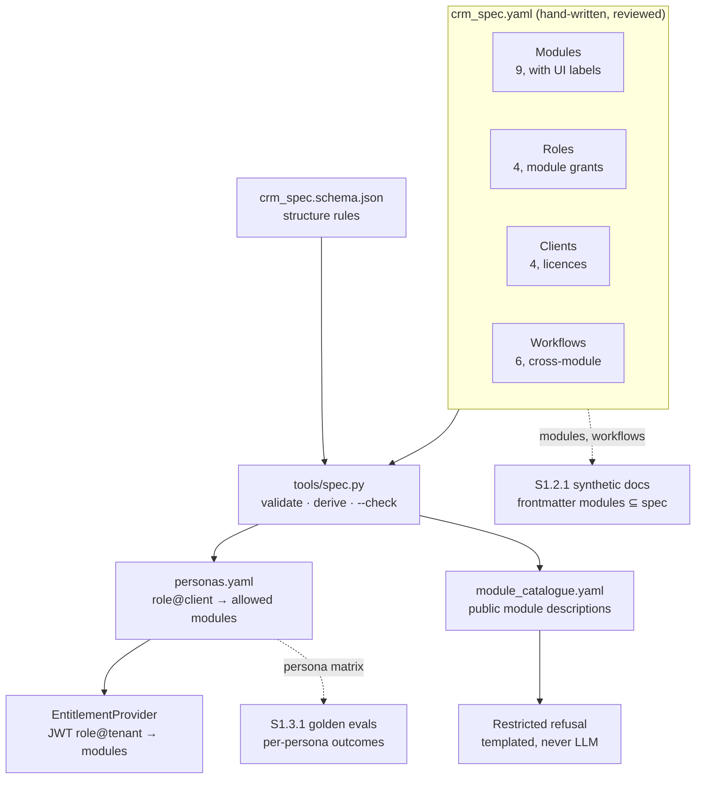

# Backlog

The single source of truth for planned work. It replaces the task list in
`CRM help chatbot MVP plan.html`, whose task IDs depend on list position and
which doesn't include the M0 and AD stories already done. Story IDs from the
original plan are kept because CLAUDE.md, the architecture doc and the ADRs
refer to them.

**Hierarchy:** Epic (E*n*) → Story (S*x.y.z* / A*n*) → Sub-tasks (checkboxes).

**Tags:**
- **est.** = estimate in days.
- **owner: you** = decisions or stakeholder work; Claude can draft.
- **[Pair]** = a deliberate learning area: tests first, built together, design
  and trade-offs explained.
- **[Delegate]** = boilerplate Claude can build fully, then you review.

**Way of working:** one story per session; start in plan mode (approach, files,
tests, "done when"), and wait for approval before writing code.

**Critical path to a meaningful demo:** S1.1.1 → S1.2.1 → S2.1.2 → S2.1.3 →
S2.2.1 → S2.3.2 → S3.1.3b.

**Order:** E1 → E2 → E3 → E4 → E5. E6 goes in once E3 is done (A1 can start
after S2.1.1). E7 comes last.

---

## E0 · Mock end-to-end ✅

The full request path with a deterministic mock in place of retrieval and
generation, and in-memory admin data.

- [x] **M0.1** Scaffold project and local JWT auth
- [x] **M0.2** Mock `POST /chat` with SSE streaming
- [x] **M0.3** Embeddable chat widget and dev harness
- [x] **AD1** Admin API mock: documents and releases
- [x] **AD2** Admin API mock: evals, costs and conversations; chats recorded
- [x] **AD3** Admin app (Vite + React) over the admin API mock

---

## E1 · Data contract and synthetic corpus

Goal: a reviewed synthetic corpus and golden eval set in the contract formats,
so retrieval and permission evals mean something.

### S0.2.1 Scope and exit criteria · est. 0.5 · owner: you
Done when: a one-page scope with measurable exit criteria is shared with stakeholders.
- [ ] In-scope and out-of-scope lists
- [ ] Exit criteria: zero permission leaks, faithfulness, refusal accuracy, time to first token, cost per query
- [ ] Confirm the restricted-module response (transparent template, as built in M0.2)
- [ ] Ask the CRM team for real module names and roles (optional)

### S1.1.1 `crm_spec.yaml` and JSON Schema · est. 1 · [Delegate] + review
Done when: the spec validates against its schema and covers every module, role, client and workflow; `personas.yaml` and `module_catalogue.yaml` come from it and a check fails if they drift.
- [x] 8–10 modules with entities and UI labels
- [x] 3–4 roles → permitted modules
- [x] 3–4 client companies → licensed modules
- [x] 5–8 cross-module workflows with prerequisites
- [x] `crm_spec.schema.json` and a validation script
- [x] Derive `personas.yaml` (licensed ∩ role-permitted, plus `core`) and `module_catalogue.yaml` from the spec; add a sync check

#### S1.1.1 design (approved 2026-11-13)

**Decisions**
- Extend, don't replace: the 4 existing personas (bold below) keep exactly
  their current modules. The README demo, the mock admin seed and the tests
  depend on them.
- The spec **generates** `personas.yaml` and `module_catalogue.yaml`, and both
  stay committed. They remain the runtime contract (in production, entitlements
  come from the CRM API, not the spec), so the loaders don't change.
  `make check` fails if they drift from the spec.
- The spec is hand-written, not LLM-generated: it's the ground truth that docs
  and evals are checked against.
- Coverage rule: every workflow has at least one persona with all of its
  modules and at least one missing exactly one, so the `multi_hop` and
  `restricted` eval categories have something to test.

**Flow**



Solid arrows are built in this story. Dotted arrows are the later E1 stories
that read the spec.

**Schema shape (draft)**

```yaml
modules:                      # closed set; every other section may only reference these
  deals:
    display_name: Deals                      # -> module_catalogue.yaml
    description: Pipelines, deal stages and stage automation.
    entities: [deal, pipeline, stage]        # used by the doc generator
    ui_labels: [Deals, Pipeline board, Stage settings]
roles:
  sales_rep: { modules: [contacts, deals, activities, quotes, products] }
clients:
  acme: { name: Acme Corp, licensed: [contacts, deals, campaigns, reports, support] }
workflows:
  - id: deal-stage-email
    title: Email contacts when a deal changes stage
    modules: [deals, campaigns]              # >= 2 modules, each must exist
    prerequisites: [a pipeline with stages, an email template]
```

The JSON Schema checks structure only: required keys, ID formats, non-empty
lists. `tools/spec.py validate` adds the checks a schema can't express:
- every reference resolves to a defined module
- `core` exists, and nothing grants or licenses it (every persona gets it automatically)
- IDs are unique
- the workflow coverage rule

**Draft roles and licences**

| Role | Grants |
|---|---|
| `sales_rep` | contacts, deals, activities, quotes, products |
| `sales_manager` | contacts, deals, campaigns, reports, activities, quotes, products |
| `marketing_manager` | contacts, campaigns, reports |
| `support_agent` | contacts, support, activities |

| Client | Licenses |
|---|---|
| `acme` | contacts, deals, campaigns, reports, support |
| `globex` | contacts, deals, campaigns |
| `kestrel` | contacts, deals, activities, quotes, reports, support (no products, on purpose) |
| `orbit` | every module |

**Persona matrix (derived: licensed ∩ role grants + core)**

● allowed · ○ licensed by the client, but the role doesn't grant it · blank = not licensed.
Bold = existing persona, unchanged. Interactive version, with a workflow
selector: [diagrams/persona-matrix.html](diagrams/persona-matrix.html).

| Persona | core | contacts | deals | campaigns | reports | activities | quotes | products | support |
|---|---|---|---|---|---|---|---|---|---|
| **`sales_rep@acme`** | ● | ● | ● | ○ | ○ |  |  |  | ○ |
| **`sales_rep@globex`** | ● | ● | ● | ○ |  |  |  |  |  |
| `sales_rep@kestrel` | ● | ● | ● |  | ○ | ● | ● |  | ○ |
| `sales_rep@orbit` | ● | ● | ● | ○ | ○ | ● | ● | ● | ○ |
| **`sales_manager@acme`** | ● | ● | ● | ● | ● |  |  |  | ○ |
| `sales_manager@globex` | ● | ● | ● | ● |  |  |  |  |  |
| `sales_manager@kestrel` | ● | ● | ● |  | ● | ● | ● |  | ○ |
| `sales_manager@orbit` | ● | ● | ● | ● | ● | ● | ● | ● | ○ |
| `marketing_manager@acme` | ● | ● | ○ | ● | ● |  |  |  | ○ |
| **`marketing_manager@globex`** | ● | ● | ○ | ● |  |  |  |  |  |
| `marketing_manager@kestrel` | ● | ● | ○ |  | ● | ○ | ○ |  | ○ |
| `marketing_manager@orbit` | ● | ● | ○ | ● | ● | ○ | ○ | ○ | ○ |
| `support_agent@acme` | ● | ● | ○ | ○ | ○ |  |  |  | ● |
| `support_agent@globex` | ● | ● | ○ | ○ |  |  |  |  |  |
| `support_agent@kestrel` | ● | ● | ○ |  | ○ | ● | ○ |  | ● |
| `support_agent@orbit` | ● | ● | ○ | ○ | ○ | ● | ○ | ○ | ● |

**Workflow coverage**

| Workflow | Modules | Full access (example) | Missing exactly one (example) |
|---|---|---|---|
| Deal stage change → triggered email | deals, campaigns | `sales_manager@acme` | `sales_rep@acme` (no campaigns) |
| Quote from a deal | deals, quotes, products | `sales_rep@orbit` | `sales_rep@kestrel` (no products) |
| Escalate a ticket to the account owner | support, contacts | `support_agent@acme` | `sales_rep@acme` (no support) |
| Campaign performance report | campaigns, reports | `sales_manager@acme` | `sales_manager@globex` (no reports) |
| Follow-up tasks from a deal | deals, activities | `sales_rep@kestrel` | `sales_rep@acme` (no activities) |
| Import contacts into an audience | contacts, campaigns | `sales_manager@acme` | `sales_rep@acme` (no campaigns) |

**Files**
- New: `data/spec/crm_spec.yaml`, `data/spec/crm_spec.schema.json`, `tools/spec.py`, `tests/tools/test_spec.py`
- Regenerated: `data/personas.yaml`, `data/module_catalogue.yaml` (header: generated, do not edit)
- Changed: `Makefile` (`spec`, `spec-check`, added to `check`), `pyproject.toml` (`jsonschema` dev dependency), `README.md` (personas table)

**Tests**
- Unknown module referenced by a role, client or workflow → rejected
- Missing `core`, or a duplicate ID → rejected
- Derivation = licensed ∩ role + `core` (on a tiny inline spec)
- The 4 existing personas resolve to exactly their current module sets
- Every workflow passes the coverage rule
- The committed generated files match the spec

**Out of scope:** docs, eval questions, LLM calls, changes to the runtime loaders.

### S1.2.1 Synthetic docs · est. 1 · ✅ done
Done when: 40–60 docs with valid frontmatter are committed, every doc's headings match its planned anchors, `make docs-check` passes in `make check`, and 10 docs are hand-reviewed.
- [x] **Step A** (no LLM): frontmatter schema, anchor convention, `data/docs/plan.yaml` and its checks
- [x] **Step B**: minimal LLM client (pulled forward from S3.1.3a): `config/models.yaml`, `LLMClient` port, LiteLLM adapter, key setting, one live smoke call
- [x] **Step C**: the generator and prompt; 3-doc pilot. v1 docs contradicted each other on shared details, so `facts:` were added to the spec (v2); v2 padded docs with core facts, so core facts now go only to core docs (v3)
- [x] **Step D**: generate the full corpus (42 docs with `docgen_v3`, all on the first attempt); `make docs-check` requires every planned doc
- [x] Hand-review the 10 docs from `make docs-sample` (flagged ones first); fix and commit

#### S1.2.1 design (approved 2026-11-13)

**The LLM writes prose; code decides structure.** `data/docs/plan.yaml` is
hand-written and reviewed like the spec. It fixes each doc's id, title,
modules and section headings (so its anchors). The generator writes the
frontmatter from the plan, never from model output (rule 4), and rejects a
generated doc whose headings differ from the plan, because S1.3.1 labels
questions against `doc_id#anchor`.

**Decisions**
- Doc-writing model: `anthropic/claude-sonnet-5.5` on OpenRouter, provider
  pinned, no fallbacks. S1.3.1 must generate questions with a different vendor.
- Provenance (model, prompt version, tokens) goes in `data/docs/MANIFEST.yaml`;
  frontmatter stays the 4-field contract real docs will follow.
- A fixed seed doesn't make LLM output reproducible (most providers ignore it).
  The committed docs are the artifact; the seed only fixes ordering and the
  review sample.
- Anchor code lives in `chatbot.ingest.anchors`, shared by upload validation,
  the release gate, `docs-check` and later the chunker.

**Conventions**
- Frontmatter: `doc_id`, `title`, `modules`, `version`, validated by
  `data/spec/doc_frontmatter.schema.json` (reused by S2.1.1).
- No H1 in the body (the title is in frontmatter); sections are H2, subsections H3.
- Anchor = slug of the heading. Anchors must be unique within a doc; duplicates
  are rejected rather than suffixed `-1`.
- Files: `data/docs/<first module>/<doc_id>.md`; workflow guides in `data/docs/workflows/`.

**Corpus (plan v1):** 42 docs (36 module docs, at least 3 per module; 6 workflow
guides, one per spec workflow, tagged with all its modules) and 6 deliberate gaps.

| Hard case | Where |
|---|---|
| Near-duplicate procedures | `contacts-import` vs `campaigns-import-to-audience`; `deals-stage-automation` / `activities-task-automation` vs `deals-follow-up-tasks`; `support-escalations` vs `support-escalate-to-owner` |
| Cross-references | `contacts-ownership` → import; `campaigns-triggered-emails` → deal-stage guide |
| Long procedure (12 steps, never split) | `support-sla-policies#set-up-an-sla-policy` |
| `#` lines in a code block | `core-search-tips#search-operators` |
| Tables | `core-navigation`, `contacts-custom-fields`, `campaigns-email-templates`, and others |
| Multi-module (rule 5) | `deals-forecasting` [deals, reports], plus all 6 workflow guides |
| Gaps (for `unanswerable` evals) | two-factor auth, contact enrichment, deal revenue split, subject-line A/B tests, quote e-signatures, CSAT surveys |

**Content leaks through prose.** A doc tagged `[deals]` that explains
triggered-email setup would hand campaigns know-how to users without
Campaigns, and the permission filter can't catch it. The prompt allows
cross-references but forbids other modules' procedures; `docs-check` flags
docs that mention another module's UI labels, and those go into the review sample.

**Canonical facts (added during the pilot).** Docs written separately invented
conflicting details (5 vs. 10 automations per stage, Paused vs. Active
defaults). The spec now has `facts:` per module and per workflow (menu paths,
limits, defaults), and each doc gets only its own modules' facts. Evals can
label `single` questions against them.

**Required labels** (already referenced by the mock responder and CLAUDE.md):
`deals-stage-automation#triggers`, `campaigns-triggered-emails#setup`,
`reports-dashboards#create-a-dashboard`, `contacts-import#csv`.

### S1.3.1 Golden eval set · est. 1.5 · ✅ done
Done when: 150+ reviewed questions with per-persona expected outcomes, and every anchor resolves.
- [x] **Step A** (no LLM): golden-set contract and outcome derivation (`chatbot.evals.golden`, tests first), hand-written seeds, `evals/synthetic/targets.yaml` built by code, `make evals-check`
- [x] **Step B**: `questiongen` role (`openai/gpt-5.4-mini`, a different vendor from the docs), prompt, generator with a copy check; 12-question pilot. The pilot's "frustrated" style made questions say "i'm stuck" and the "why they need it" style forced filler, so the styles were reworded (`questiongen_v2`)
- [x] **Step C**: 151 questions generated and hand-reviewed (20 sampled across every category, 13%). Review found questions reusing the docs' invented examples ("Renewal date"), so `questiongen_v3` forbids that and a check rejects quoted doc examples; 4 questions regenerated

#### S1.3.1 design (approved 2026-11-16)

**The LLM writes the wording; code decides the truth.** A target fixes each
question's category, required `doc_id#anchor` labels and personas before any
LLM runs. Per-persona outcomes are **derived**: `answer` if the persona holds
every module of every required doc, otherwise `restricted` with exactly the
missing modules; `unanswerable` is `not_found` and `out_of_scope` is
`out_of_scope`. `make evals-check` re-derives every stored outcome and fails
on drift, orphaned labels, unknown personas or duplicate questions.

**Rules**
- A question a workflow guide answers is labelled with the guide and counts as
  `single`; `multi_hop` is only for questions needing 2+ docs no guide covers
  (CLAUDE.md example updated to match).
- Multi-hop with partial access is `restricted`: there is no "partial answer"
  outcome. Revisit with an ADR if end-to-end evals show users want one.
- Unanswerable questions only get personas holding the gap's modules, so the
  outcome is unambiguously `not_found`.
- Restricted and adversarial targets use sections some personas can see and
  others can't (every persona has `core` and `contacts`), with one answer
  persona as a control.
- 2–3 personas per question, picked by code with a seed; retrieval and
  permission evals can still loop over all 16.

**Rate limits.** New OpenRouter accounts get 20 requests a minute per model.
Model roles can set `rpm:` in `config/models.yaml`, and the LiteLLM client
paces itself to stay under it (both generator roles use 18).

**Targets (seed 20261116):** 151 = 60 single, 26 multi_hop (13 seeded pairs × 2),
20 restricted, 15 adversarial (5 attack types × 3), 15 unanswerable (6 gaps),
15 out_of_scope. All 42 docs and all 16 personas are covered.

---

## E2 · Storage and ingestion

Goal: a versioned, permission-tagged index built by `make ingest`.

**E2 decisions (approved 2026-11-16)**
- Order: S2.1.1 and S2.1.2 first (no infrastructure), then S1.4.1 and S2.1.3.
  Container runtime: Colima (`colima start --memory 3 --cpu 2`).
- Database access: Alembic + SQLAlchemy for migrations only; at runtime,
  psycopg 3 + pgvector with hand-written SQL, so the `modules <@` filter stays
  visible and testable.
- DB tests use a `db` pytest marker: skipped locally when Postgres is down,
  but `REQUIRE_DB=1` turns a skip into a failure (CI, and `make check` once
  Docker is part of the dev setup).
- Until the S2.4.1 gate exists, `make ingest` promotes with `ungated: true`
  recorded on the index version; S2.4.1 makes the gate mandatory.
- Known modules come from the module catalogue (the `ModuleCatalogue` port).

### S1.4.1 Compose and DB baseline · est. 0.5 · [Delegate] · ✅ done
Done when: `make up` starts Postgres + pgvector and Phoenix, and Alembic runs against them.
- [x] `compose.yaml`: `pgvector/pgvector:0.8.7-pg16-bookworm`, `arizephoenix/phoenix:21.1.0`; localhost-only ports, 1 GB cap each, Colima VM 3 GB
- [x] `make up` (starts Colima, waits for health, migrates) / `down` / `migrate` / `db-shell` / `db-reset`; always the `colima` Docker context
- [x] Alembic in `src/chatbot/db/migrations/` (hand-written SQL, no autogenerate); baseline = `CREATE EXTENSION vector`; `CHATBOT_DATABASE_URL` setting
- [x] `db` pytest marker on a separate `chatbot_test` DB; skips when Postgres is down, fails with `REQUIRE_DB=1`

### S2.1.1 Fail-closed validation · est. 0.5 · ✅ done
Done when: an untagged or mis-tagged doc aborts the run with a clear error.
- [x] `chatbot/ingest/validate.py` (`DocValidator`) replaces the mock checks; admin upload and ingestion runs share it
- [x] Frontmatter: the JSON Schema contract, duplicate YAML keys rejected, every module must be known
- [x] Body: no H1 (title is in frontmatter), no setext headings, no unclosed code block, first heading `##`, no skipped levels, unique non-empty anchors
- [x] Run: any error in any doc aborts the whole run listing every error; duplicate `doc_id`s and an empty corpus abort too

### S2.1.2 Heading-aware chunker · est. 1 · [Pair] · ✅ done
Done when: chunker snapshot tests pass and no numbered procedure is split.
- [x] Fixture docs and snapshot tests (reviewed before implementation)
- [x] Split on headings; prefix the breadcrumb; carry anchors (`chatbot/ingest/chunker.py`, `anchors.sections_of`)
- [x] Never split numbered procedures (checked on the corpus at 512 and at a forced 100-word limit)
- Wiring the bge-m3 tokenizer as `count_tokens` lands with S2.1.3, which loads the model anyway

#### S2.1.2 design (approved 2026-11-17)

**One chunk per heading section, never a fixed-size window.** Windows cut
procedures in half and blur which `doc_id#anchor` a chunk belongs to, which
makes complete recall fuzzy. The cost is uneven chunk sizes (about 70–350
tokens on today's corpus), which is acceptable at that spread.

**Rules**
- A `##` or `###` section is a chunk holding only its own text. A `##` with no
  text before its first `###` has no chunk; its anchor still resolves to its
  children. `###` chunks record `parent_anchor` (for parent-section expansion).
- Text before the first heading is a chunk with the reserved anchor `_intro`
  (`slugify` never produces `_`, so it cannot collide).
- Limit: 512 tokens of embedded text. A longer section is split only between
  blocks: a paragraph, a whole list (loose lists and nested bullets included),
  a table or a code block. A paragraph ending in `:` stays with the block after
  it. A single block over the limit stays whole and is flagged `oversized`.
  Small sections are never merged (it would mix anchors).
- Embedded text = breadcrumb line + blank line + section text. Breadcrumb =
  `Doc title > Section > Subsection`: the title, not the module, because
  multi-module docs have no single module and module words would bias search.
  Modules live only in the `modules` column, copied from frontmatter.
- Tokens are counted by an injected function: bge-m3's tokenizer in ingestion,
  a word count in tests.
- `chunk_id` = `doc_id#anchor:part` (part 0 unless split). `content_hash` is
  over the embedded text. `config_hash` (chunker version, limit, tokenizer)
  goes in the index version's recipe.

**Tests** (`tests/ingest/test_chunker.py`, fixtures in `tests/fixtures/chunker/`):
hand-written expected snapshots per edge case; invariants on fixtures and the
real corpus (no text lost or duplicated, lists/tables/code whole and in one
chunk, anchors real, modules equal frontmatter); a snapshot of the corpus
chunk IDs and token counts. `UPDATE_SNAPSHOTS=1` accepts a deliberate change.

### S2.1.3 Embeddings and index versions · est. 1.5
Done when: two ingest runs produce two index versions, promote and rollback work, and unchanged chunks reuse cached embeddings.
- [ ] Migrations: `index_versions`, `active_index`, `chunks`, `embedding_cache`, `module_catalogue`
- [ ] bge-m3 on MPS behind an `Embedder` port
- [ ] Content-hash embedding cache
- [ ] Build a complete version, promote, rollback commands
- [ ] Generated tsvector column; GIN index on `modules`

---

## E3 · Retrieval and the publish gate

Goal: a retrieval baseline you can quote and a zero-tolerance permission gate.

### S2.2.1 Filtered hybrid search · est. 1 · [Pair]
Done when: hybrid search returns only chunks whose modules are all allowed.
- [ ] Filter-construction tests first (`modules <@ :allowed` inside the SQL)
- [ ] Exact vector search with the filter (no ANN index)
- [ ] FTS with the same filter
- [ ] Reciprocal rank fusion

### S2.2.2 Reranker · est. 0.5
Done when: candidates are reranked by bge-reranker-v2-m3 and a score threshold is configurable.
- [ ] `Reranker` adapter on MPS
- [ ] Threshold in config

### S2.3.1 Retrieval eval harness · est. 0.75 · [Pair]
Done when: `make eval` prints recall@k, complete recall@k and MRR by category and saves results per run.
- [ ] Resolve anchors to chunk IDs for the active version
- [ ] Metrics per category
- [ ] JSON results and a readable report

### S2.3.2 Permission suite · est. 0.5 · [Pair]
Done when: zero violations across the persona matrix and property tests; any leak fails the build.
- [ ] Tests first: persona-matrix assertion `chunk.modules ⊆ allowed`
- [ ] Hypothesis property test with random entitlement sets
- [ ] Record the retrieval baseline

### S2.4.1 Gate in `make ingest` · est. 0.5
Done when: a version is promoted only if the permission suite, retrieval thresholds and orphaned-label check all pass.
- [ ] Permission suite gate
- [ ] Recall regression vs. the live version
- [ ] Orphaned `doc_id#anchor` labels block promotion

---

## E4 · Real query path

Goal: replace the mock `Responder` with grounded, cited, streamed, traced answers.

### S3.1.3a LLM client and config · est. 0.5 · [Delegate]
Partly pulled forward into S1.2.1 step B (models.yaml, port, LiteLLM adapter, key setting); what's left here is wiring it into the query path.
- [ ] `config/models.yaml` with pinned model IDs
- [ ] LiteLLM → OpenRouter, provider pinned, fallbacks off
- [ ] `LLMClient` port; mocked in tests

### S3.1.3b Grounded generation · est. 1.5
Done when: answers stream with verified citations, and low-confidence and restricted cases get the right response.
- [ ] `prompts/answer_v1` with the static prefix first
- [ ] Structured `{answer, steps, citations}`
- [ ] Verify cited chunk IDs were in the context
- [ ] Below threshold: "not found" or the restricted template from `module_catalogue`
- [ ] `RagResponder` replaces the mock responder

### S3.1.2 Rewrite and decomposition · est. 1
Done when: cross-module questions retrieve chunks from every relevant module.
- [ ] Rewrite call `{standalone, sub_queries}`, Pydantic-validated, raw-question fallback
- [ ] Skip on the first turn
- [ ] Parallel retrieval per sub-query; merge, dedupe, rerank against the standalone query
- [ ] Per-module diversity and parent-section expansion

### S3.1.5 Server-owned conversations · est. 0.5
- [ ] `conversations` / `messages` tables
- [ ] 404 for a `conversation_id` the caller doesn't own
- [ ] Redacted storage; 30-day deletion

### S3.1.4 Tracing and cost rows · est. 0.75
Done when: every request appears in Phoenix with per-step spans and version metadata, and LLM calls write cost rows.
- [ ] OpenTelemetry spans per pipeline step → Phoenix
- [ ] Entitlement set, index, prompt and model versions, token counts on every trace
- [ ] `llm_calls` and `model_prices`

### S3.1.1 Auth and entitlements · mostly done in M0.1
- [ ] Verify the TTL cache on entitlement resolution; close any gaps

---

## E5 · Generation evals and model choice

### S3.2.1 Judge and metrics · est. 1
Done when: faithfulness, correctness, refusal and citation scores run from `make eval-gen`.
- [ ] Metrics: faithfulness, correctness, refusal accuracy, citation accuracy
- [ ] Judge from a different vendor than the generator
- [ ] Retries with backoff, bounded concurrency

### S3.2.2 Judge calibration · est. 0.5
- [ ] Hand-label 30+ answers
- [ ] Report judge-vs-human agreement

### S3.3.1 Model bake-off · est. 0.75
Done when: an ADR records the chosen model with quality, latency and cost evidence.
- [ ] Candidates available on both OpenRouter and Bedrock only
- [ ] Optional Ollama run (`num_ctx` 8192)
- [ ] Time to first token and cost per query
- [ ] ADR-0007 model choice

---

## E6 · Admin app on the real backend

Goal: replace the in-memory admin mock with Postgres, reusing E2–E5 code.

- [ ] **A1** Documents persistence: `documents`, `document_versions`, upload via the S2.1.1 validator, `audit_log`
- [ ] **A2** Jobs and `build_release`: `jobs` table (SKIP LOCKED), `make worker`, publish runs the S2.4.1 gate, access-widening confirmation, rollback
- [ ] **A4** Costs from `llm_calls`
- [ ] **A5** Evals from `eval_runs`: authoring and YAML import, synthetic `proposed` questions, manual end-to-end run, labels

---

## E7 · Guardrails, demo, handover

### S4.2.1 Guardrails and red team · est. 1
- [ ] Rate limits per user and per tenant
- [ ] Output length cap and off-topic response
- [ ] Red-team session: prompt injection and cross-module leakage
- [ ] Every successful attack becomes an eval case

### S4.3.1 Demo script · est. 1
Done when: a dry run finishes in under 10 minutes without surprises.
- [ ] Same question as two personas, two correct answers
- [ ] Phoenix trace walkthrough
- [ ] Eval scores
- [ ] Dry run and fixes

### S5.1.1 Stabilise · est. 2
- [ ] Fix eval regressions and flaky tests
- [ ] Setup from a clean clone; update the README

### S5.2.1 Production handover · est. 1
- [ ] Stub-replacement table
- [ ] ADRs: no orchestration framework, synthetic data strategy, reranker compute
- [ ] Real-data swap checklist; production backlog
